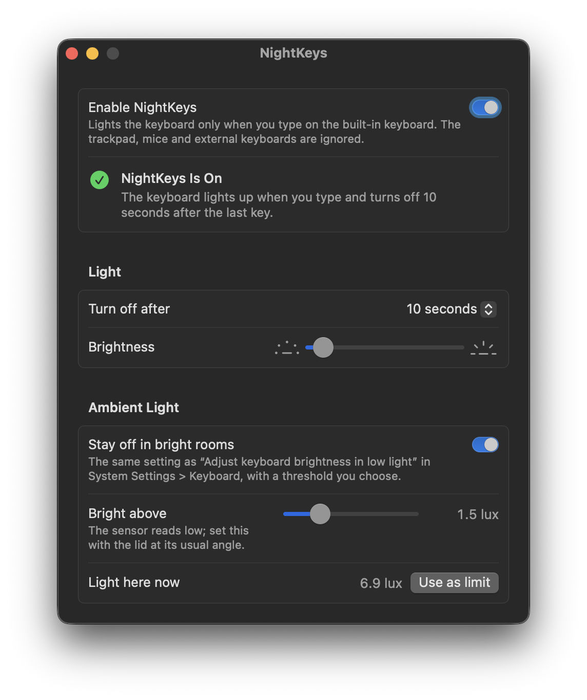

# NightKeys

**Only your keys wake the keyboard light.**

<p align="center">
  
</p>

A MacBook lights its keyboard for any input. If you use the trackpad in a dark room, like I do, the keys light up
every time you scroll or move the pointer, and they stay lit as long as you keep using it. Turning the backlight off
doesn't help either, because then it's dark when you do want to type.

NightKeys lights the keyboard **only when you type on the built-in keyboard**. Touching the trackpad, moving a mouse
or typing on an external keyboard no longer wakes the light. When you stop typing, it goes off after the timeout set
in **System Settings > Keyboard**.

- Optionally stays off in bright rooms, using the ambient light sensor and a threshold you pick
- Uses the timeout, low-light mode and brightness from **System Settings > Keyboard**, so a change in either place
  shows up in both
- About 3 MB of memory and no CPU while idle; it sleeps until you press a key (see [Footprint](#footprint))

## Requirements

- A MacBook with a backlit built-in keyboard and Apple silicon
- macOS 13 Ventura or later

Tested on a 14-inch MacBook Pro (Apple silicon) with macOS 26.7.1 Tahoe.

## Install

### Homebrew

```sh
brew install --cask fratayaydn/tap/nightkeys
```

### Download

Download `NightKeys-<version>.dmg` from the [latest release](https://github.com/fratayaydn/nightkeys/releases/latest),
open it and drag **NightKeys** to **Applications**. The app is signed with a Developer ID and notarized by Apple.

### First run

1. Open **NightKeys** and turn on **Enable NightKeys**.
2. Allow NightKeys in **Input Monitoring** when macOS asks (or use the button in the window), then click
   **Check Again**.

You can close the window; NightKeys keeps running in the background. To change a setting later, open **NightKeys**
again from Applications or Spotlight.

## Settings

| Setting | Where it lives |
| --- | --- |
| Turn off after (5 s … 5 min, Never) | macOS: "Turn keyboard backlight off after inactivity" |
| Brightness | macOS keyboard brightness (also Control Center) |
| Stay off in bright rooms | macOS: "Adjust keyboard brightness in low light" |
| Bright above (lux threshold) | NightKeys only |

The window shows the live reading of the light sensor. Press **Use as limit** in a room where the keyboard
should no longer light up. The sensor sits behind the display bezel and reads low (a fully lit room is often
only about 10 lux), and the lid angle changes the reading noticeably, so calibrate at your usual angle.

Turning off **Enable NightKeys** stops the background agent and hands the backlight back to macOS.

## Footprint

The background agent uses about 3 MB of memory and no CPU while idle. It doesn't poll: it only receives built-in
keyboard events, so using the trackpad never wakes it. It makes no network connections. The settings window runs
only while it is open and quits when you close it.

Measured on macOS 26.7.1 with `footprint` and `top`.

## Permissions

NightKeys needs **Input Monitoring** to notice when a key on the built-in keyboard is pressed.
It never records, stores or sends what you type; it only notes *that* a key was pressed.

macOS only re-checks this permission when a process starts, so NightKeys checks it each time its window opens.
If you allow or remove it while the window is open, click **Check Again**.

## How it works

- `NightKeys.app/Contents/MacOS/nightkeysd` is a small background agent, registered as a login item through
  `SMAppService`. It listens to the built-in keyboard only (`IOHIDManager` matching `Built-In`), so trackpad
  events never reach it.
- It takes over the backlight through the private `CoreBrightness` framework: it suspends the system's idle
  dimming, turns the light on at your brightness when you type and off after the timeout. When it stops, it
  gives control back to macOS.
- It reads the ambient light sensor through the private `DisplayServices` framework only while you type: when a
  typing session starts and at most every 15 seconds during it, never on a timer.
- `CoreBrightness` change notifications keep it in sync with System Settings.
- `NightKeys.app/Contents/MacOS/NightKeys` is the SwiftUI settings window. It runs only while open.
- The agent watches its app bundle through the kernel's event queue (no polling): when the app is replaced by
  an update it restarts with the new version, and when the app is moved to the Trash it quits for good.

NightKeys uses private Apple frameworks. That is why it is not on the App Store, and a future macOS update may
break it. If that happens, please open an issue.

## Building from source

Requires the Xcode Command Line Tools (`xcode-select --install`).

```sh
git clone https://github.com/fratayaydn/nightkeys.git
cd nightkeys
make install
```

This builds `NightKeys.app`, copies it to `/Applications` and opens it. To update, pull and run `make install`
again: settings, the permission and the login item are kept.

### Code signing

macOS ties both the Input Monitoring permission and the login item to the app's code signature. With an ad-hoc
signature every build has a new identity, so each update would lose the permission and leave the background
agent unable to start. Local builds are therefore signed with a self-signed certificate that
`scripts/create-signing-identity.sh` creates on the first build (valid for 10 years, the private key stays in
your login keychain). The same certificate signs every build, so updates keep working.

Even so, Background Task Management pins the login item to the exact build it registered. `scripts/install.sh`
handles that: it unregisters the agent, replaces the app, registers it again and starts it once, which makes
macOS accept the new build.

To sign with your own Apple Developer ID instead:
`make install SIGN_IDENTITY="Developer ID Application: Your Name (TEAMID)"`.

## Uninstall

Move **NightKeys** from Applications to the Trash (or `brew uninstall --cask nightkeys`). The background agent
notices, gives the keyboard backlight back to macOS and quits. Your settings are kept in case you install it again.

To remove the settings too, use `brew uninstall --zap --cask nightkeys` instead, or run
`defaults delete io.github.fratayaydn.nightkeys` after moving the app to the Trash. If you built it from source,
`make uninstall` in the cloned folder removes both the app and the settings.

Optionally remove NightKeys from **System Settings > Privacy & Security > Input Monitoring**.

## Command line

```sh
/Applications/NightKeys.app/Contents/MacOS/nightkeysd --status   # prints the ambient light reading
```

## More small Mac apps

- [BalanceKeeper](https://github.com/fratayaydn/balancekeeper): puts the left/right audio balance back when macOS
  shifts it
- [CapsNow](https://github.com/fratayaydn/capsnow): turns off the Caps Lock delay, so quick taps register
- [MicKeeper](https://github.com/fratayaydn/mickeeper): keeps AirPods and iPhones off the microphone, so AirPods don't
  drop to call quality
- [FullscreenKeeper](https://github.com/fratayaydn/fullscreenkeeper): reopens apps in full screen if you quit them in
  full screen

## License

MIT license, see [LICENSE](LICENSE).

The crow in the app icon is the [Font Awesome Free "crow" icon](https://fontawesome.com/icons/crow) by Fonticons,
Inc., licensed under [CC BY 4.0](https://creativecommons.org/licenses/by/4.0/). See
[Resources/ThirdParty](Resources/ThirdParty/README.md).
